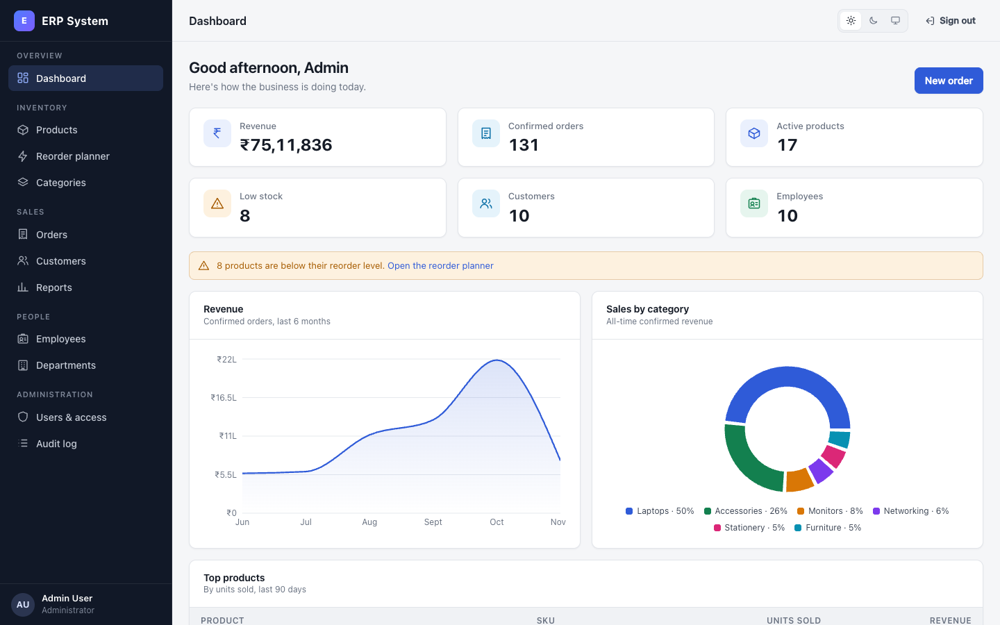
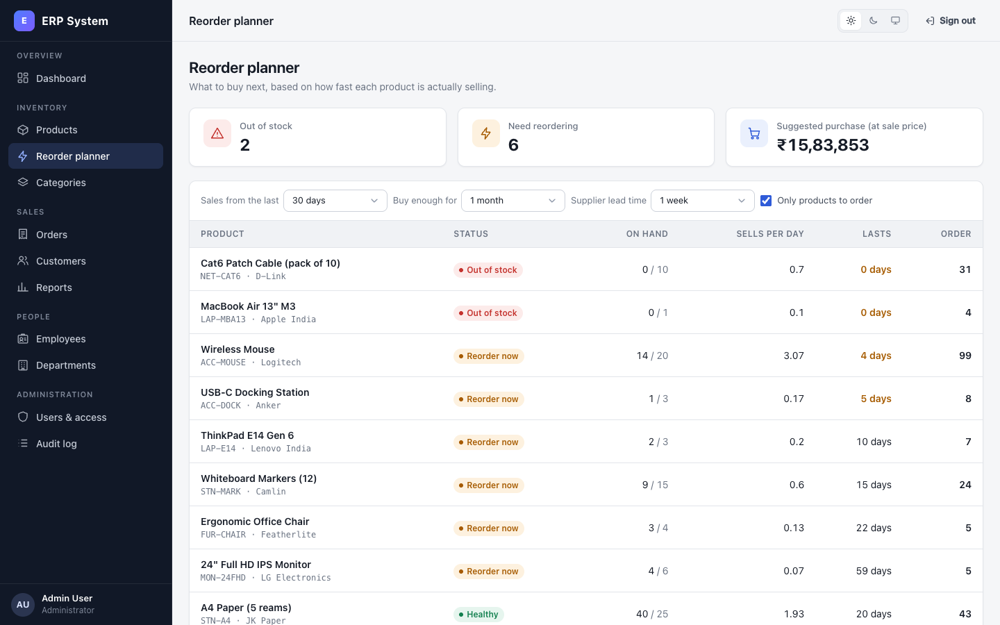
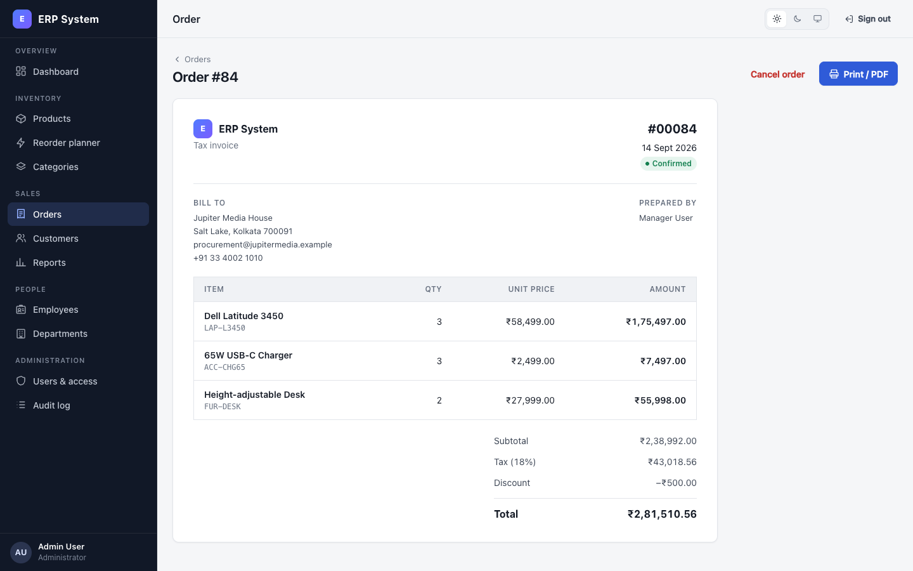
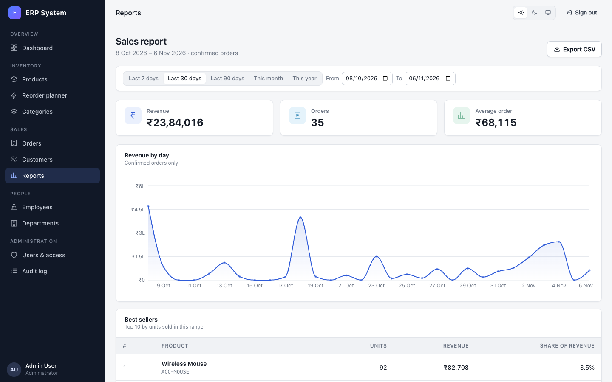
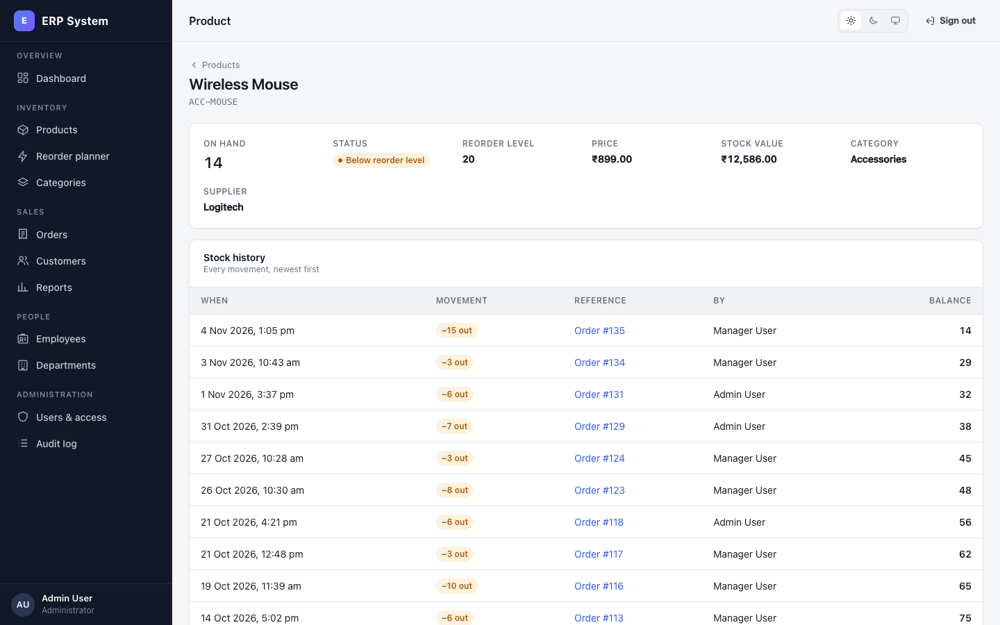
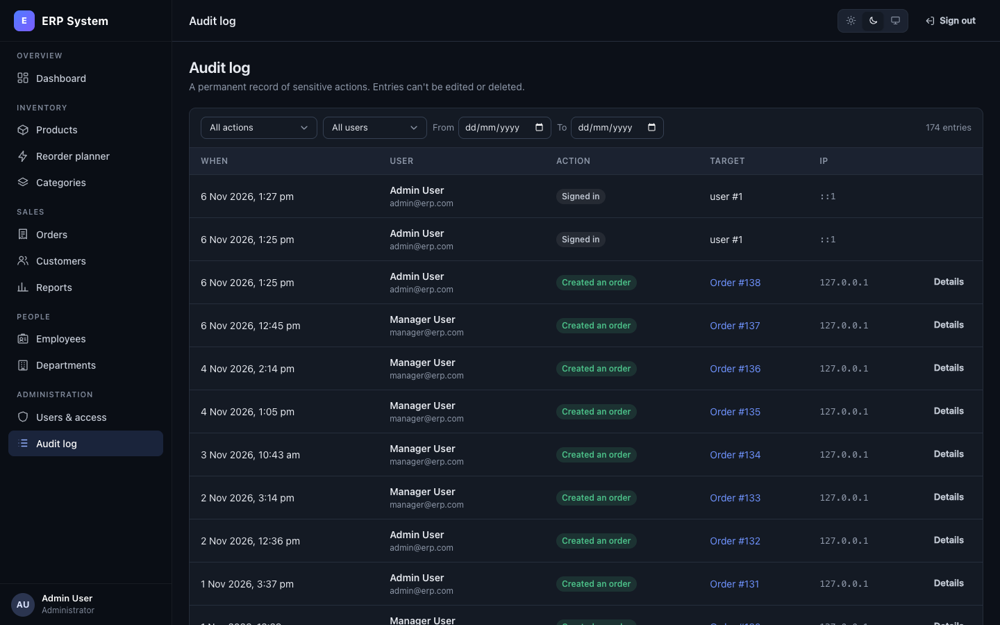
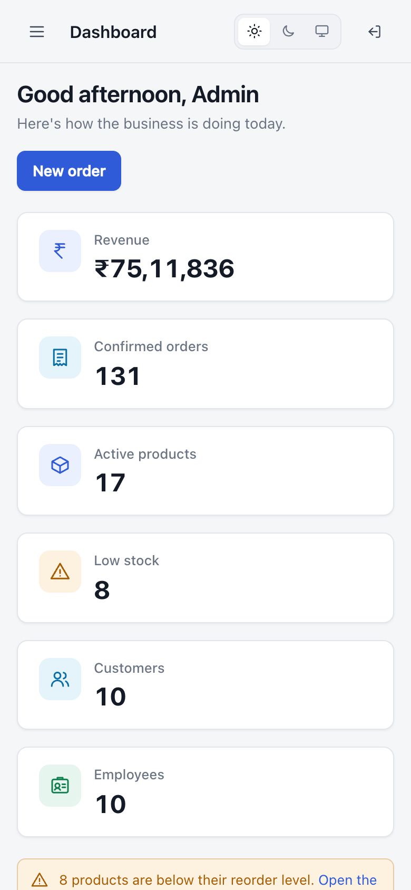
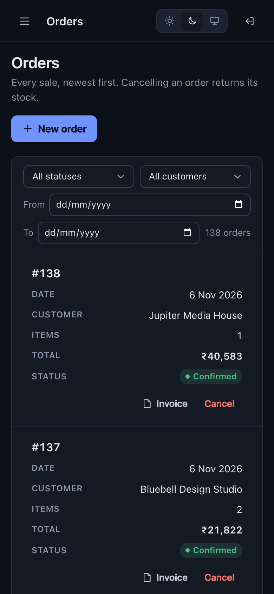
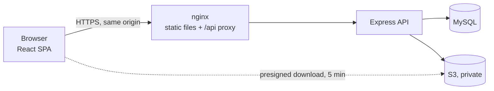

# ERP System

Inventory, sales and HR for a small business in one web app, with four roles
(Admin, HR, Manager, Employee), each seeing only what it should. It also turns
order history into an answer to "what should we buy next?".

[](https://github.com/arynnn0812/erp-system/actions/workflows/ci.yml)

**React 18 · Node.js 22 / Express · MySQL 8 · AWS S3 · Docker**



| | |
|---|---|
|  **Reorder planner**: sales velocity, days of stock left and what to buy |  **Invoices**: printable, from prices frozen at the time of sale |
|  **Sales report**: revenue by day, best sellers, CSV export |  **Stock ledger**: every movement, with the balance after it |
|  **Audit log** (dark theme) |   **Phones**: tables become cards |

*Screenshots of the running app with the bundled demo data.*

## Try it

With Docker, about two minutes:

```bash
git clone https://github.com/arynnn0812/erp-system.git && cd erp-system
cp .env.example .env
# set MYSQL_ROOT_PASSWORD, DB_PASSWORD and JWT_SECRET in .env, e.g. with: openssl rand -base64 32
docker compose up -d --build --wait
docker compose run --rm api node scripts/seed.js --demo
```

Open http://localhost:8080 and sign in with any demo account (password `Password@123`):

| Account | Sees |
|---|---|
| `admin@erp.com` | Everything, including users and access, and the audit log |
| `manager@erp.com` | Inventory, orders, customers, reports, the reorder planner, staff without salaries |
| `hr@erp.com` | Employees with salaries, departments, employee documents |
| `employee@erp.com` | The inventory dashboard, the product catalogue, and their own profile, salary and documents |

The demo data is six months of a small IT-equipment distributor:
- 17 products in 6 categories, 10 customers;
- about 140 orders, a few of them cancelled;
- a restock halfway through.

It is created through the same code paths as the app, so every stock level is
explained by its ledger.

## What it does

**Inventory**
- Products and categories, with search, paging and soft delete.
- Stock in and out, recorded in an append-only ledger.
- Low-stock alerts.
- A **reorder planner** that works out, from real sales:
  - how fast each product sells;
  - how many days of stock are left;
  - how many to order.

  The sales window, cover period and supplier lead time are adjustable, and
  the page explains its own formula.

**Sales**
- Customers, and multi-line orders with tax and discount.
- Each order is all-or-nothing: the stock check, stock-out, order and ledger
  rows commit together or not at all, even under concurrent orders for the
  same product.
- Cancelling an order returns its stock.
- Every order is a printable invoice.
- Reports by date range, and CSV export that Excel opens cleanly.
  Formula-like cells are neutralised.

**HR**
- Departments and employees.
- Salaries visible to Admin and HR only. They are left out of the query
  itself for other roles.
- Salary changes are audited with the old and new values.
- Each employee can see their own record and documents.

**Documents**
- Files on employees and products, stored in a private S3 bucket.
- The file's type is checked from its content, not just its name.
- Downloads are links that expire after 5 minutes.

**Administration**
- User accounts and roles. An admin can't lock themselves out.
- A read-only audit log of sign-ins, access changes, stock movements,
  orders, salary changes and document access.

**Dashboard**
- Headline figures and sales charts, shaped by role: sales for Admin and
  Manager, headcount for Admin and HR.
- Updates live. A change to orders, stock, customers or staff reaches every
  open dashboard within about a second (Server-Sent Events), with polling as
  the fallback.

**Everywhere**
- Light, dark and system themes.
- Works on phones.
- Keyboard-accessible dialogs.
- Every page loads on its own and fails on its own.

## How it is built



The API is layered: `routes → middleware (auth, roles, validation) →
controllers → services → models`. Rules that must always hold live in services
and SQL, not in the UI. Some of the less obvious parts:

- **No overselling.**
  - Stock changes lock the product row (`SELECT … FOR UPDATE`).
  - Multi-product orders lock their rows in id order, so two orders can't
    deadlock.
  - A `CHECK (quantity >= 0)` backs it up in the database.
- **Sessions that can be revoked.**
  - The JWT lives in an httpOnly, `SameSite=Strict` cookie.
  - A per-user `token_version` is checked on every request, so signing out
    everywhere, a password change, deactivation or a role change takes
    effect immediately.
- **Three levels of access control:**
  - by role on each route;
  - by record in the services (an employee reads only their own documents);
  - by field in SQL (salary).
- **Money is exact.** It is MySQL `DECIMAL` end to end, sent as strings in
  JSON.

[docs/ARCHITECTURE.md](docs/ARCHITECTURE.md) covers the whole design: data
model, request flow, security model, the reorder maths, and the trade-offs and
known limits.

### Why this stack

- **MySQL with InnoDB.** An ERP's hard problems are transactional: stock,
  money, and several people selling the last unit at once. Row locks, CHECK
  constraints, foreign keys and `DECIMAL` solve them in the database. Each
  is tested against a real MySQL, not a mock.
- **Express, in plain layers.** There's no framework magic between a route
  and its SQL, which keeps the code easy to read and to review. The
  dependencies are few and each earns its place:
  - helmet, express-validator and express-rate-limit;
  - pino for logging;
  - mysql2 and the AWS SDK.
- **React without a UI kit.** A small design system written in plain CSS
  (tokens for both themes, about fifteen components) gives full control over
  accessibility and responsiveness. The first load is about 91 KB of gzipped
  JavaScript.
- **S3 for files.** The API never stores or streams file contents. Downloads
  go straight from S3 with short-lived links.

## Development

You need Node 20.19+ and MySQL 8.

```bash
cd backend
npm install
cp .env.example .env        # database credentials and JWT secret; S3 optional
npm run migrate             # creates the database, applies database/migrations
npm run seed:demo           # demo logins + six months of data (npm run seed: logins only)
npm run dev                 # API on http://localhost:4000, restarts on changes

cd ../frontend              # in a second terminal
npm install
npm run dev                 # http://localhost:5173, proxies /api to the API
```

Schema changes go in a new numbered file in `database/migrations/`; `npm run
migrate` applies anything new and is safe to re-run.

Configuration:
- **Backend:** everything is in `backend/.env.example`. The API checks it all
  at startup and lists every problem at once. The full reference is in
  [docs/DEPLOYMENT.md](docs/DEPLOYMENT.md#environment-variables-api).
- **Frontend:**
  - `API_URL` is the dev proxy target (default `http://localhost:4000`).
  - `VITE_SHOW_DEMO_ACCOUNTS=true` lists the demo accounts on the sign-in
    page of a production build. They are always listed in development.

### Tests

```bash
cd backend
DB_PASSWORD=yourpassword npm test   # needs a MySQL; uses its own erp_test database
npm run lint
cd ../frontend && npm run lint && npm test && npm run build
```

There are 90 backend integration tests (Vitest + Supertest, against real
MySQL). They cover:
- role, record and field-level access, and session revocation;
- atomic orders, rollbacks and concurrent stock-outs;
- constraint errors;
- CSV formula escaping;
- the reorder maths, against hand-worked numbers;
- configuration validation and health probes;
- the live dashboard stream: who may open it, what a write sends, and that it
  closes when the session is revoked;
- that the OpenAPI spec matches the real routes.

And 22 frontend tests (Vitest + Testing Library, in jsdom with the API
mocked), covering:
- the menu each role sees;
- the route guard;
- sign-in;
- the dashboard per role;
- live updates reconnecting, and falling back to polling.

CI runs all of it on every pull request. It then builds the Docker images,
starts the stack and runs `scripts/smoke-test.sh` through nginx.

## Documentation

| | |
|---|---|
| [docs/API.md](docs/API.md) | Signing in, conventions, errors, the role matrix and examples |
| [docs/openapi.yaml](docs/openapi.yaml) | OpenAPI 3.1 reference for all 58 endpoints |
| [docs/postman/](docs/postman/) | Postman collection and local environment; sign in once and every request is authenticated |
| [docs/ARCHITECTURE.md](docs/ARCHITECTURE.md) | Design, data model, concurrency, security model, trade-offs |
| [docs/DEPLOYMENT.md](docs/DEPLOYMENT.md) | Docker Compose or a plain VM: TLS, first admin, backups, monitoring, go-live checklist |
| [docs/ROADMAP.md](docs/ROADMAP.md) | How the project was upgraded, phase by phase, and why |

## Project structure

```
erp-system/
├── backend/
│   ├── src/
│   │   ├── routes/ middleware/ validators/ controllers/ services/ models/
│   │   ├── config/        validated env, MySQL pool, S3 client
│   │   └── utils/         audit, errors, CSV, cookies, logger
│   ├── scripts/           migrate, seed (+ demo data), create-admin
│   ├── test/              integration tests (real MySQL)
│   └── Dockerfile
├── frontend/
│   ├── src/
│   │   ├── pages/         one folder per area (inventory, sales, hr, admin)
│   │   ├── components/ui/ the design system
│   │   ├── styles/        tokens (light + dark), base, layout, components
│   │   ├── hooks/ context/ config/nav.js (role access, shared by menu and routes)
│   ├── test/              component and hook tests (jsdom)
│   ├── nginx/             production web server config
│   └── Dockerfile
├── database/migrations/   versioned SQL
├── docs/                  API, OpenAPI, Postman, architecture, deployment, screenshots
├── deploy/                systemd unit for non-Docker installs
├── scripts/               smoke-test.sh (post-deploy check), build-postman.js
├── docker-compose.yml     MySQL + migrations + API + web
└── .github/workflows/     CI
```
