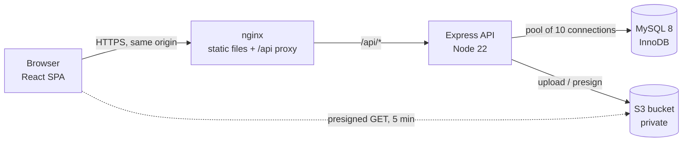
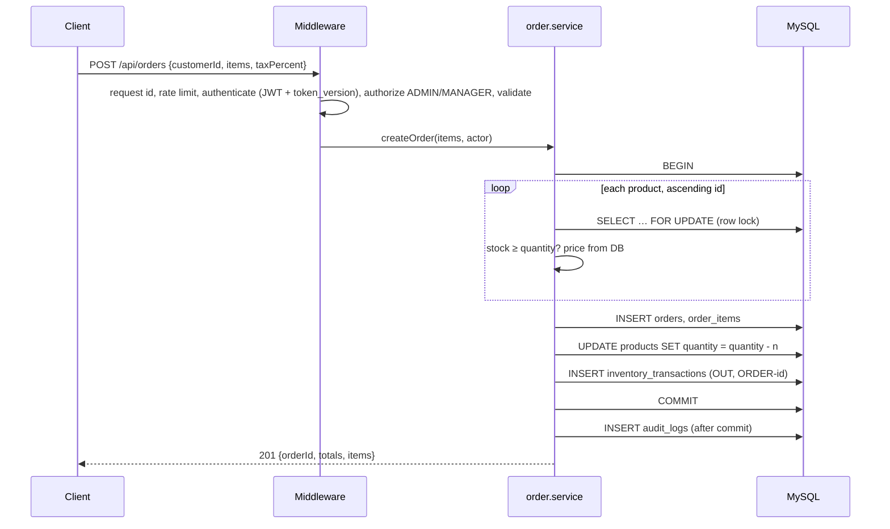
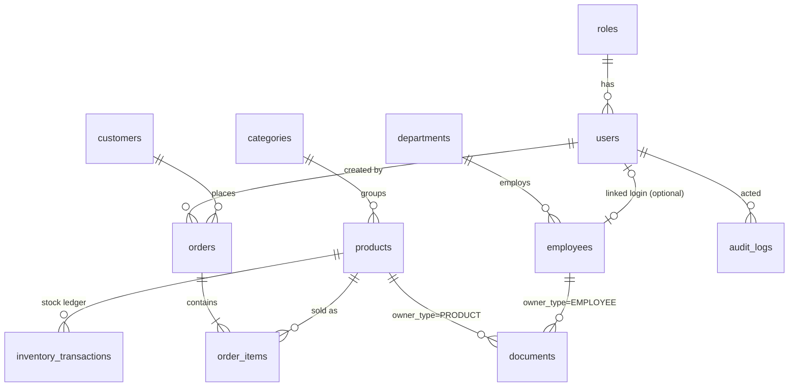

# Architecture

This explains how the ERP is put together and why: the parts, the request
path, the security model, the data model, and the places where correctness
depends on a specific technique. It ends with the trade-offs and known limits.
For endpoints see [API.md](API.md); for running it see [DEPLOYMENT.md](DEPLOYMENT.md).

## The system



- **One origin.** nginx serves the built React app and proxies `/api`. The
  browser never makes a cross-origin call, so CORS is not part of the
  production picture, and the session cookie can be `SameSite=Strict`.
- **Stateless API.** All state is in MySQL (and files in S3). Any API
  instance can serve any request, apart from the in-memory rate limiter
  counters (see [Trade-offs](#trade-offs-and-known-limits)).
- **Files bypass the API on the way out.** Downloads are presigned S3 URLs
  that expire after 5 minutes, so large files never stream through Node. The
  bucket stays private.

## Backend layers

```
routes/        URL + method → middleware chain. No logic.
middleware/    authenticate, authorize(roles), validate, upload, requestLogger, errorHandler
validators/    express-validator rules: shape, ranges, sanitising (trim, lowercase, toInt)
controllers/   read the request, call one service or model, shape the response
services/      business rules and transactions (orders, stock, users, HR, documents)
models/        SQL, and nothing else. Parameterised queries only.
utils/         audit(), ApiError, csv, cookies, logger, lifecycle
config/        validated environment, MySQL pool, S3 client
```

The rule that keeps this honest: **anything that must be true no matter who
calls it lives in a service or model, not in a route or the UI.** Examples:

- Order totals are computed from database prices inside the order
  transaction. The client never sends a price.
- Salary is left out of the `SELECT` for roles that may not see it
  (`employee.model.js`), instead of being deleted from the JSON afterwards.
- "Only an admin can link a login to an employee record" is checked in
  `hr.service.js`. The UI hiding the field is a convenience, not the control.

Each layer is replaceable on its own: tests call services directly, and the
seed scripts drive the same services as the HTTP API.

### One request, end to end

Creating an order, the most involved write:



Any failure before `COMMIT` rolls everything back. Examples are a product
with too little stock (422), an inactive product, or a discount larger than
the order.

## Authentication and sessions

- **Token.** A JWT signed with HS256. Verification pins the algorithm, so a
  token cannot choose how it is checked. It carries the user id and a
  `tv` (token version).
- **Transport.** The browser gets it as the `erp_session` cookie:
  - httpOnly, so page scripts (and XSS) cannot read it;
  - SameSite=Strict, so other sites cannot make the browser send it, which
    is the CSRF defence;
  - `Path=/api`;
  - Secure in production.

  Scripts can send it as `Authorization: Bearer` instead.
- **Revocation without a session table.** `users.token_version` is checked
  on every request. Signing out everywhere, changing or resetting a
  password, deactivation and role changes all increment it, and that
  invalidates every token issued before.
- **Role from the database.** `authenticate` loads `is_active`,
  `token_version` and the role by primary key on each request. A demotion
  takes effect on the next request, not when the token expires.
- **Sign-in hardening.**
  - Unknown email and wrong password give the same 401, and both run a
    bcrypt comparison (a dummy hash for unknown emails), so response time
    does not reveal which emails exist.
  - Failed attempts are rate limited per IP.
  - Every attempt is audited, failed ones included.
  - Passwords need 10+ characters and are capped at 72 bytes (bcrypt
    ignores anything beyond that).

## Authorization

Authorization is enforced at three levels:

1. **Route.** `authorize('ADMIN', 'MANAGER')` answers "may this role use this
   endpoint at all". The role table is in [API.md](API.md#roles).
2. **Record.** Services check ownership where the role alone is not enough.
   An EMPLOYEE may read the documents of the employee record linked to their
   own login, and no other. Anyone refused gets the same 403 whether or not
   the record exists, so ids cannot be probed.
3. **Field.** Salary is only selected for ADMIN and HR. A person always
   sees their own salary through `/api/auth/profile`.

Guard rails on access management:
- An admin cannot change their own role or deactivate themselves, so the
  last admin cannot lock everyone out.
- Only an admin can link a login to an HR record, because the link grants
  that login the record's salary and documents.

The React app mirrors the role rules in one place, `frontend/src/config/nav.js`,
for both the sidebar and the route guards. It is a usability layer only:
every rule is enforced again by the API.

## Data model



- **Money is `DECIMAL`**, never `FLOAT`, and travels as a string in JSON so it
  is never rounded on the way.
- **The database enforces invariants too.**
  - `CHECK (quantity >= 0)` on stock, plus non-negative prices and totals.
  - `UNIQUE` on SKU, emails and names.
  - Foreign keys everywhere except one polymorphic column (below).
  - Constraint violations become 409 or 400 in the error handler, not 500.
- **Products are deactivated, not deleted.** Old orders and the stock ledger
  keep pointing at them.
- **Documents are polymorphic.** `(owner_type, owner_id)` refers to an
  employee or a product, so there is no foreign key. The service checks the
  owner exists on upload, and deleting an employee who still has documents
  is refused (409) rather than leaving orphaned files in S3.
- **Migrations** are numbered SQL files in `database/migrations`, applied in
  order by `scripts/migrate.js` and recorded in `schema_migrations`. Applied
  files are never edited; a change is a new file.

## Correctness under concurrency

Stock is the number that must never be wrong. Four mechanisms keep it right:

- **Row locks.** Every stock change happens in a transaction that first
  reads the product with `SELECT … FOR UPDATE`. Two simultaneous sales of
  the last unit queue on the lock: one succeeds and the other sees 0 and
  gets a 422. A test fires concurrent stock-outs at one product and checks
  there is no oversell and no lost update.
- **Lock order.** An order touching several products locks them in
  ascending id order. Two orders for the same products in a different order
  can then never hold one lock each and wait forever on the other.
- **Price snapshot.** `order_items.unit_price` is copied from the product
  inside the transaction. A later price change does not alter old orders,
  so reprinting an invoice always shows what was charged.
- **The ledger.** `inventory_transactions` records every IN and OUT with
  who did it and a reference:
  - `ORDER-42` for a sale;
  - `ORDER-42-CANCEL` for a cancellation;
  - `PO-…` for a purchase.

  The product page shows the balance after each movement, using a SQL
  window function (`SUM(±quantity) OVER (ORDER BY id)`). The demo seed
  checks at the end that every product's stock equals the sum of its ledger.

Cancelling an order returns its stock in a single transaction. The order row
is locked first, so the same order cannot be cancelled twice in parallel.

## Reorder planner

`GET /api/products/insights/reorder` is one SQL query over the product table
and confirmed order lines:

```
daily velocity  = units sold in the last D days ÷ D
days of stock   = quantity ÷ velocity            (none when nothing sold)
suggested order = ceil(velocity × C + reorder level − quantity), at least 0
status          = OUT      when quantity = 0
                  REORDER  when quantity < reorder level, or days of stock < lead time
                  OK       otherwise
```

D (sales window), C (days to cover) and the supplier lead time are query
parameters, set from the page. The reorder level acts as safety stock. The
formulas are deliberately simple and explained on the page itself, so a
manager can check a suggestion by hand.

## Audit log

`utils/audit.js` writes one row per sensitive action:
- sign-ins, failed ones included;
- access and password changes;
- stock movements;
- creating and cancelling orders;
- salary changes, with the old and new values;
- employee changes;
- document uploads, downloads and deletes.

Each row records who, what, the target, JSON details and the client IP.
There is no API to change or delete entries. The IP is only right when
`TRUST_PROXY` matches the number of proxies (see DEPLOYMENT.md).

## Documents

1. Multer reads uploads into memory, up to 5 MB.
2. The first bytes must match the declared type, so a renamed executable is
   rejected. The allowed types are PDF, PNG, JPEG and DOCX.
3. The file is stored under `employees/<id>/<uuid>-<name>`.
4. Downloads are 5-minute presigned GETs, and each one is audited.
5. Without S3 settings the document endpoints return 503 with a clear
   message, and everything else keeps working.

## Live dashboard

The dashboard refreshes itself when the data behind it changes, without
polling the database.

1. `middleware/notifyChanges.js` watches every request under products,
   categories, customers, orders and employees. When a write (anything but
   GET) finishes with a 2xx or 3xx status, it publishes a `dashboard` change
   on an in-process event bus (`utils/events.js`). A burst of writes within
   0.5 s is one event.
2. `GET /api/dashboard/stream` is a Server-Sent Events response. Each open
   stream forwards the change as `event: change`, and sends a `: ping`
   comment every 25 s, under nginx's 60 s read timeout. `X-Accel-Buffering:
   no` stops nginx from holding events back.
3. In the browser, `useLiveUpdates` opens an `EventSource`, and on each
   change the dashboard refetches its endpoints. The figures stay on screen
   while the new ones load.

Design decisions:
- **No data in events.** An event only says "something changed". The
  refetch goes through the normal endpoints, which apply the role rules, so
  the stream cannot leak a figure its viewer may not see.
- **SSE, not WebSockets.** Traffic is one-way, from server to browser. SSE is
  plain HTTP: it carries the session cookie, passes through nginx and the
  Vite proxy, and reconnects by itself. It needs no new dependency on either
  side.
- **Sessions are checked again.** A stream outlives the request that
  opened it. On every heartbeat, and before forwarding a change, it checks
  the session again. Logout-everywhere, deactivation, a role change or
  expiry ends the stream.
- **Limits.** Each user may have 5 open streams. On shutdown every stream is
  ended, so that `server.close()` is not held open until the forced exit.
- **Fallbacks.** After a network drop, `EventSource` reconnects and the
  dashboard refreshes once, to catch anything it missed. After an error
  response, such as a 502 while the API restarts or a 401, the browser stops
  retrying. The hook then polls every minute and tries the stream again
  every 30 s. A badge in the header shows the state: Live, Connecting or
  Auto-refresh.

## Frontend

- **Stack.** React 18 and React Router 7, built by Vite. No UI library: a
  small design system in plain CSS lives in `src/styles` (tokens for light
  and dark themes) and `src/components/ui`:
  - Button, Field, Modal, Toast, ConfirmDialog, DataTable, and more.
  - Modals trap focus and restore it when they close.
  - Tables turn into labelled cards on phones.
- **Loading.**
  - Each page is a lazy-loaded chunk with its own error boundary.
  - The first load ships about 91 KB of gzipped JS.
  - The chart library loads only on pages with charts.
- **Data.** `useApi` and `usePagedList` fetch on demand. A guard drops stale
  responses, so typing fast in a search box cannot show an older result.
  There is no global store: the server is the source of truth, and each page
  asks for what it shows.
- **Session.** `AuthContext` asks `/api/auth/me` on load. The cookie
  answers, and no token is ever stored in JavaScript-readable storage.
- **Theme.** `public/theme-init.js` sets the saved theme before first paint.
  It is a file rather than inline script, so the Content-Security-Policy can
  stay `script-src 'self'`.

## Operations

- **Startup.**
  - `config/buildConfig.js` validates the whole environment at once and
    refuses unsafe production settings.
  - The API retries MySQL for about 20 s, then exits.
- **Health.**
  - `/api/health/live` is the process only.
  - `/api/health/ready` means MySQL answers within 2 s and the process is
    not shutting down.
- **Logs.**
  - pino JSON lines go to stdout, each with a request id taken from nginx's
    `X-Request-Id` or generated.
  - Passwords, cookies and authorization headers are redacted.
- **Shutdown.** On SIGTERM the API reports not-ready, stops accepting new
  connections, lets in-flight transactions finish and closes the pool. If
  that takes longer than 10 s, it is forced.
- **Packaging.**
  - Docker images run as non-root, and the API container is read-only with
    no Linux capabilities.
  - Compose runs migrations as a one-shot step before the API starts.

## Testing

- **Integration tests against real MySQL.** 90 tests in `backend/test`
  (Vitest + Supertest), on a database they create and drop. The interesting
  failures are about transactions, locks and constraints, which a mocked
  database would not reproduce.
- **What they cover:**
  - role and field-level access;
  - session revocation;
  - atomic orders and rollbacks;
  - concurrent stock-outs;
  - constraint errors mapped to 409/400;
  - CSV formula escaping;
  - the reorder math, against hand-computed values;
  - configuration validation and the health probes;
  - the live stream: roles, coalescing, silence on reads and failed writes,
    revocation, the per-user cap and shutdown. These run against a real
    listening port;
  - that `docs/openapi.yaml` matches the registered routes.
- **Frontend tests.** 22 tests in `frontend/test` (Vitest + Testing
  Library, in jsdom), with the API mocked:
  - the menu per role and the route guard;
  - sign-in, including the redirect back and the error message;
  - which endpoints the dashboard calls for each role;
  - refreshing on a live event;
  - the live-update hook, driven by a fake `EventSource` and fake timers:
    reconnect, polling fallback, retry and cleanup.
- **CI** (`.github/workflows/ci.yml`):
  - lint, the tests on MySQL 8.4, and dependency audits;
  - the frontend tests and build;
  - a job that builds the Docker images, starts the stack and runs
    `scripts/smoke-test.sh` through nginx.

## Trade-offs and known limits

- **Live updates are per process.** The event bus is in memory, so with
  several API instances a write reaches only the streams on its own
  instance; dashboards connected to another one miss it until their next
  refresh. Redis pub/sub would make the bus shared.
- **Rate limits are per process.** The counters live in memory. With N API
  instances a client gets roughly N times the limit. A shared store (Redis)
  is the fix before scaling out.
- **Audit rows are written after the commit**, and a failed audit write is
  logged, not raised. A crash in the instant between the two loses that
  audit row, but never the business change. Writing the audit row inside
  the same transaction would close the gap, at the cost of more complex
  services.
- **One extra query per request.** Loading the user's auth state by primary
  key on every request is the price of instant revocation and demotion. It
  is a single indexed lookup.
- **No refresh tokens.** A session simply lasts `JWT_EXPIRES_IN`, by
  default a day.
- **Orders go straight to CONFIRMED.** The schema has a `PENDING` status,
  and the list filter accepts it, but no flow creates pending orders yet
  (there are no quotes or drafts).
- **Single company, single currency.** There is no tenant column, and
  amounts are rupees with GST-style tax as a percentage.
- **Search uses `LIKE '%term%'`.** This is fine at this scale. A large
  catalogue would want a FULLTEXT index.
